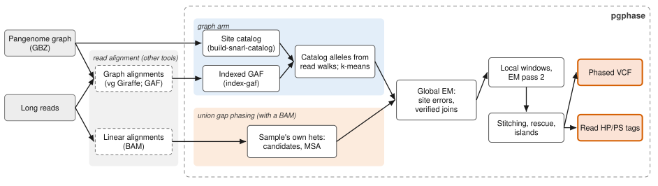
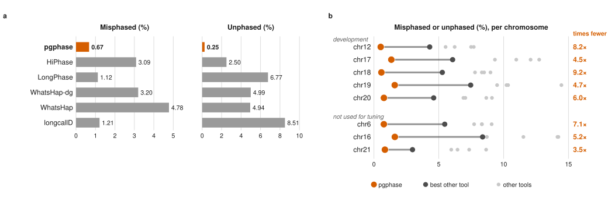

<h1 align="center">pgphase</h1>

<p align="center"><b>Pangenome graph-aware phasing of long reads</b></p>

<p align="center">
  <a href="https://github.com/kokyriakidis/pgphase/actions/workflows/ci.yml"></a>
  <a href="LICENSE"></a>
</p>

pgphase assigns every long read (PacBio HiFi or ONT) to the parental haplotype it was sequenced from, writing
haplotype (`HP`) and phase set (`PS`) tags for each read and a phased VCF. It phases at the known alleles of a
pangenome graph, observed directly in the reads' graph alignments, together with the sample's own heterozygous
variants, which it finds in the reads' linear alignments. **No separate variant caller is needed.**



## Highlights

<!-- results:begin (generated by make paper; edit tools/paper/render.py) -->

On HG002 PacBio HiFi reads, with the parent of origin of every read as truth on eight chromosomes (three of them not used for tuning), compared with HiPhase, LongPhase, WhatsHap and longcallD:

- **99.08%** of 2,623,162 phaseable reads phased correctly, against 94.41% for the best other tool (HiPhase).
- **3.5–9.2× fewer** reads misphased or unphased than the best other tool, on every chromosome.
- **58 switch errors** on the chromosome arms against 105 for the next best (LongPhase); checked against the haplotype sequences, only 10 of them are real phasing errors, against 41–220 for the other tools. In centromeric satellites: 42 against 177–471.
- **No separate variant caller**: 7.1 minutes for pgphase against 125–141 for DeepVariant followed by LongPhase or HiPhase (same chromosomes and threads).



| Tool | Correct (%) | Misphased (%) | Unphased (%) | Switches, arms | of which real | Switches, satellites | Minutes, with variant calling |
|---|---:|---:|---:|---:|---:|---:|---:|
| **pgphase** | 99.08 | 0.67 | 0.25 | 58 | 10 | 42 | 7 |
| HiPhase | 94.41 | 3.09 | 2.50 | 178 | 119 | 402 | 141 |
| LongPhase | 92.11 | 1.12 | 6.77 | 105 | 41 | 349 | 125 |
| WhatsHap | 90.28 | 4.78 | 4.94 | 364 | 220 | 471 | 164 |
| WhatsHap-dg | 91.81 | 3.20 | 4.99 | 208 | 130 | 363 | 169 |
| longcallD | 90.28 | 1.21 | 8.51 | 200 | 115 | 177 | 8 |

*Phaseable*: reads that span a heterozygous truth variant. *Misphased*: assigned to the wrong parent relative to the other reads of their phase set. A *switch* is a lasting change of a phase set's orientation against the truth; *real* switches are those that remain once the tool's haplotype sequences are compared with the truth's (the others are the same haplotypes written with different records, or cannot be told apart). *Satellites*: the centromeric and pericentromeric intervals.

Phaseable reads on the chromosome arms over chr6, chr12, chr16–chr21; minutes over the five chromosomes where every tool ran with six threads, excluding read alignment. Details in the paper (`paper/`); scores in `tools/paper/results.json`.

<!-- results:end -->

## Contents

- [Installation](#installation)
- [Quick start](#quick-start)
- [Inputs and outputs](#inputs-and-outputs)
- [Commands and options](#commands-and-options)
- [How it works](#how-it-works)
- [Reproducing the paper](#reproducing-the-paper)
- [Testing](#testing)
- [Citing](#citing)
- [Licence and acknowledgements](#licence-and-acknowledgements)

## Installation

Requirements:

- a C++17 compiler (GCC 8+ or Clang 7+)
- [htslib](https://github.com/samtools/htslib) with headers, zstd, zlib and pthreads
- [Rust](https://rustup.rs) (cargo), to build `pgcat`, which builds the site catalogs and indexes alignments
- [vg](https://github.com/vgteam/vg), only to build site catalogs
- [samtools](https://github.com/samtools/samtools), only for `collect-bam-variation --refine-aln`
- [pixi](https://pixi.sh), to build plegma, the noisy-region MSA (it fetches plegma's Mojo toolchain); without it,
  `make PLEGMA=0` builds pgphase with abPOA alone. plegma (`third_party/plegma`) is a private repository for now:
  without access to it, the recursive clone skips it and `make PLEGMA=0` builds the rest

```bash
git clone --recursive https://github.com/kokyriakidis/pgphase.git
cd pgphase
make third-party-libs   # WFA2-lib, abPOA and plegma
make -j"$(nproc)"       # pgphase
make pgcat              # placed beside pgphase, which finds it there (then on PATH; PGCAT=PATH overrides)
./pgphase --version
```

`make portable-bundle` writes a self-contained binary with its shared libraries to `dist/pgphase-<os>-<arch>/`.
plegma's library and the Mojo runtime it needs are a few MB in `third_party/plegma/build/` (glibc 2.35 and the
libstdc++ of GCC 12 or newer); the bundle carries them.

## Quick start

pgphase needs the reference FASTA, a site catalog built once from the graph, the reads' graph alignments indexed
by reference position, and (recommended) the same reads' linear alignments as an indexed BAM.

**1. Build the site catalogs**, once per graph:

```bash
pgphase build-snarl-catalog --graph graph.gbz --reference-sample CHM13
```

**2. Index the reads' graph alignments** (GAF, for example from vg Giraffe) by reference position:

```bash
pgphase index-gaf --graph graph.gbz --gaf reads.gaf.gz --reference-sample CHM13
```

**3. Phase:**

```bash
pgphase collect-graph-variation \
    --ref chm13.fa \
    --sites graph.catalog \
    --gaf reads.coord.gaf.gz \
    --bam reads.bam \
    -r 'CHM13#0#chr20' \
    -o candidates.tsv \
    --phased-vcf-out phased.vcf \
    --phased-bam-out phased.bam
```

Leave out `--bam` to phase from the graph alignments alone; with it, the sample's own heterozygous variants join
the catalog's sites ("union gap phasing"), the recommended mode.

<details>
<summary><b>More on the site catalog</b></summary>

`build-snarl-catalog` writes `graph.catalog/<contig>.pgsites` (or, with `--out DIR`, `DIR/<contig>.pgsites`) for
every reference contig: every snarl the reference path `CHM13#0#<contig>` passes through, at every nesting level,
with all its alleles, in position order. It is what `vg deconstruct -a` reports, without the genotypes and allele
counts, which need the haplotype names and take most of its time. `--sites graph.catalog` then gives pgphase every
contig.

- `--reference-sample` may be left out when the graph declares a single reference sample
  (`pgcat reference-samples graph.gbz` lists them); HPRC graphs declare both CHM13 and GRCh38.
- Contigs may be named either way: `chr20`, or the path name `CHM13#0#chr20`.
- `--region chr20` (repeatable) builds chosen contigs, and `--region chr20:10000000-12000000` part of one, as
  `chr20_10000000-12000000.pgsites`.
- Each contig's snarls come from its own connected component (`vg chunk -C`, then `vg snarls`, several contigs at
  a time) and are kept in the catalog's `snarls/` folder for later runs on the same graph.

On the HPRC v2.1 CHM13 graph (10 cores), all 25 contigs take about 31 minutes and the machine peaks at 64 GB; the
catalogs total 1.5 GB (chr20's is 37 MB, against 656 MB as a sites-only VCF). `--level` trades time for size
(zstd, default 6).

A `.pgsites` file holds the catalog's VCF lines in independently zstd-compressed position blocks with an index, so
a region query reads only the blocks it needs. `pgcat view graph.catalog/chr20.pgsites [chr20:START-END]` prints
it as VCF. pgphase also reads a bgzipped, tabix-indexed sites VCF (one file for every contig).

</details>

<details>
<summary><b>More on indexing the alignments</b></summary>

`index-gaf` places every alignment on the reference by the nodes of its walk that lie on the reference sample's
paths, and writes `reads.coord.gaf.gz` (sorted, bgzipped) with its tabix index. Unmapped alignments, and those
without a unique reference interval, are left out and counted. Header lines record the longest alignment on each
contig, which pgphase uses to skip sites no read can traverse. The GAF may be plain, gzip or bgzip; sorting spills
to disk beyond `--memory` (a quarter of the machine's memory). chr20 of HG002 HiFi (5.7 GB of GAF) takes 61 s.

</details>

## Inputs and outputs

| Input | |
|---|---|
| `--ref FILE` | Reference FASTA, indexed |
| `--sites PATH` | Site catalogs from `build-snarl-catalog` (the folder, or one `.pgsites` file), or a tabix-indexed sites VCF |
| `--gaf FILE` | The reads' graph alignments, indexed by `index-gaf` |
| `--bam FILE` | The same reads' linear alignments, indexed (optional, recommended) |

| Output | |
|---|---|
| `--phased-vcf-out FILE` | Heterozygous calls, phased (`GT:DP:AD:VAF:GQ:PS`) |
| `--phased-bam-out FILE` | One unaligned record per read seen, with `HP` and `PS` tags when phased |
| `-o FILE` | Every candidate site with its allele counts, category and phase |
| `-v FILE` | The candidate sites as a VCF |

The read tags can be copied onto an aligned BAM by read name, for example for haplotype-aware analyses.

## Commands and options

| Command | What it does |
|---|---|
| `collect-graph-variation` | Phase reads from their graph alignments, optionally with their linear alignments (`--bam`) |
| `build-snarl-catalog` | Build the site catalogs from a GBZ graph (runs `pgcat build`) |
| `index-gaf` | Index the reads' graph alignments by reference position (runs `pgcat index-gaf`) |
| `collect-bam-variation` | Phase from linear alignments alone; a C++ port of [longcallD](https://github.com/yangao07/longcallD)'s phasing |

`collect-graph-variation` options:

| Option | Description | Default |
|---|---|---|
| `-t INT` | Worker threads | all cores |
| `-q INT` | Minimum mapping quality | 5 (1 with `--bam`) |
| `-D INT` | Minimum total depth | 5 |
| `--min-alt-depth INT` | Minimum alternative-allele depth | 2 |
| `--min-af FLOAT` / `--max-af FLOAT` | Allele fraction band of a heterozygous site | 0.20 / 0.80 |
| `--chunk-size INT` | Region chunk size | 500000 (1000000 with `--bam`) |
| `-r STR` / `--region-file FILE` | Restrict to regions | whole genome |
| `--hifi` / `--ont` | Read technology | `--hifi` |
| `--msa NAME` | Noisy-region MSA: `plegma`, or `abpoa` (longcallD's) | `plegma` |
| `--msa-model FILE` | plegma's homopolymer model (shasta2 csv), or `none` | built in: HiFi; ONT R10.4.1 with `--ont` |

`pgphase <command> --help` lists every option, including diagnostic outputs.

Without graph alignments, `collect-bam-variation` phases from the linear alignments alone, as longcallD does:

```bash
pgphase collect-bam-variation --ref ref.fa --bam reads.bam --hifi \
    -o candidates.tsv --phased-vcf-out phased.vcf -b phased.bam
```

## How it works

1. **Known alleles from the graph.** Each snarl of the graph is a site; a read's allele there is the walk its graph
   alignment takes, observed without calling. The catalog's clean sites are phased first by k-means clustering of
   the reads, as in longcallD.
2. **The sample's own variants.** With `--bam`, each chunk is also solved from the linear alignments: candidate
   variants, and noisy regions resolved by partial-order multiple sequence alignment
   ([plegma](https://github.com/kokyriakidis/plegma), one consensus per haplotype, homopolymer lengths decided by
   a model of how the reads report them; [`models/`](models/README.md)). Its heterozygous variants join the
   catalog's sites.
3. **One expectation-maximization over all sites** learns each site's phase and error rate, shrunk toward the
   error of sites of the same kind.
4. **Joins the reads verify.** Two blocks are joined only when several reads carry evidence on both sides at
   reliable sites; collapsed duplications, poorly mapped sites and one-base length differences label reads but
   join nothing.
5. **The remaining reads** are labelled from local haplotype windows, the orientation of excluded sites and
   island blocks that never join anything.

[`docs/IMPLEMENTATION.md`](docs/IMPLEMENTATION.md) describes every rule and threshold as the code implements it.

## Reproducing the paper

The manuscript lives in `tools/paper/`: the text in `main_text.py` and `supplement.py`, the references in
`refs.py`, and every table, figure and quoted number, including the [Highlights](#highlights) above, computed from
`tools/paper/results.json` by `tables.py`.

```bash
make paper        # regenerates paper/ (an Overleaf project), build/paper/ (HTML, PDFs) and this README's results
make paper-sync   # pushes the committed paper/ to the Overleaf project (FORCE=1 the first time)
```

Edit `tools/paper/`, not the generated `paper/`. `python3 tools/paper/check_refs.py` checks every DOI against
Crossref. The scripts that run every tool and produce `results.json` are in
[pgphase-dev](https://github.com/kokyriakidis/pgphase-dev).

## Testing

```bash
make unit-tests       # unit tests
make predicate-tests  # phasing, repeat and stitching predicates
make parity-tests     # ported functions against longcallD's semantics
make pgcat-tests      # pgcat unit tests
make check            # end-to-end golden tests on test_data/, at 1 and 4 threads, per MSA
```

`make check` runs each golden test once with plegma (`test_data/expected/plegma/`) and once with `--msa abpoa`
against longcallD's outputs (`test_data/expected/`); `UPDATE_GOLDEN=plegma make check` rewrites plegma's goldens
after an intended change.

`make upstream-parity-tests LONGCALLD_ROOT=/path/to/longcallD` compiles longcallD's original C and checks the
ported phasing functions against it.

## Citing

If you use pgphase, please cite it (see [`CITATION.cff`](CITATION.cff)):

```bibtex
@software{pgphase,
  author  = {Kyriakidis, Konstantinos and Paten, Benedict},
  title   = {pgphase: pangenome graph-aware phasing of long reads with known and sample-specific variants},
  url     = {https://github.com/kokyriakidis/pgphase},
  license = {MIT}
}
```

## Licence and acknowledgements

MIT; see [`LICENSE`](LICENSE). pgphase's alignment pipeline is derived from
[longcallD](https://github.com/yangao07/longcallD) (MIT). It uses [htslib](https://github.com/samtools/htslib),
[plegma](https://github.com/kokyriakidis/plegma), [abPOA](https://github.com/yangao07/abPOA),
[WFA2-lib](https://github.com/smarco/WFA2-lib),
[edlib](https://github.com/Martinsos/edlib) and, in pgcat, the [gbz](https://github.com/jltsiren/gbz) library;
[`THIRD_PARTY_NOTICES.md`](THIRD_PARTY_NOTICES.md) lists them with their licences.
