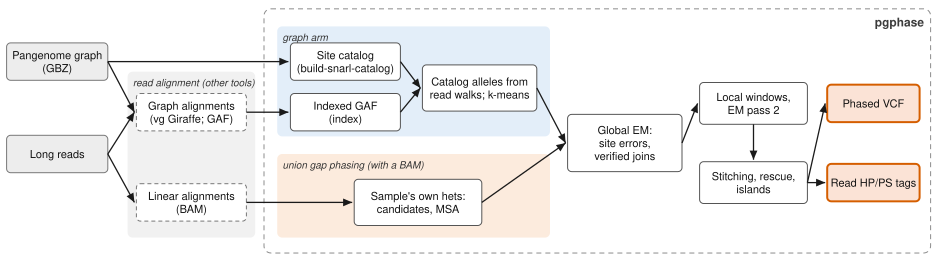
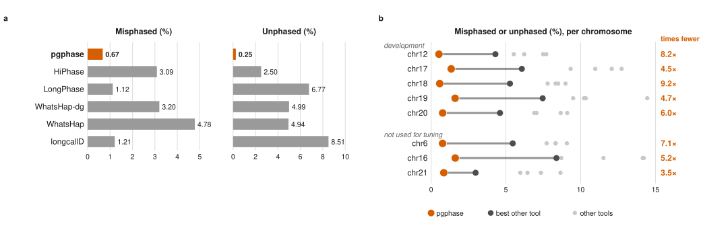

<h1 align="center">pgphase</h1>

<p align="center"><b>Pangenome graph-aware phasing and variant calling for long reads</b></p>

<p align="center">
  <a href="https://github.com/kokyriakidis/pgphase/actions/workflows/ci.yml"></a>
  <a href="LICENSE"></a>
</p>

**pgphase** assigns long sequencing reads (PacBio HiFi and Oxford Nanopore) to their parental haplotypes (`HP` and `PS` BAM tags) and emits a phased germline VCF (`GT:DP:AD:VAF:GQ:PS`). It combines known pangenome alleles observed directly on graph walks (`GAF`) with sample-private variants discovered and resolved via haplotype-aware partial-order MSA on linear alignments (`BAM`/`CRAM`)—**requiring no external variant caller**.



---

## Highlights

<!-- results:begin (generated by make paper; edit tools/paper/render.py) -->

On HG002 PacBio HiFi reads, with the parent of origin of every read as truth on eight chromosomes (three of them not used for tuning), compared with HiPhase, LongPhase, WhatsHap and longcallD:

- **99.08%** of 2,623,162 phaseable reads phased correctly, against 94.41% for the best other tool (HiPhase).
- **3.5–9.2× fewer** reads misphased or unphased than the best other tool, on every chromosome.
- **58 switch errors** on the chromosome arms against 105 for the next best (LongPhase); checked against the haplotype sequences, only 10 of them are real phasing errors, against 41–220 for the other tools. In centromeric satellites: 42 against 177–471.
- **No separate variant caller**: 7.1 minutes for pgphase against 125–141 for DeepVariant followed by LongPhase or HiPhase (same chromosomes and threads).



| Tool | Correct (%) | Misphased (%) | Unphased (%) | Switches, arms | of which real | Switches, satellites | Minutes, with variant calling |
|---|---:|---:|---:|---:|---:|---:|---:|
| **pgphase** | 99.08 | 0.67 | 0.25 | 58 | 10 | 42 | 7 |
| HiPhase | 94.41 | 3.09 | 2.50 | 178 | 119 | 402 | 141 |
| LongPhase | 92.11 | 1.12 | 6.77 | 105 | 41 | 349 | 125 |
| WhatsHap | 90.28 | 4.78 | 4.94 | 364 | 220 | 471 | 164 |
| WhatsHap-dg | 91.81 | 3.20 | 4.99 | 208 | 130 | 363 | 169 |
| longcallD | 90.28 | 1.21 | 8.51 | 200 | 115 | 177 | 8 |

*Phaseable*: reads that span a heterozygous truth variant. *Misphased*: assigned to the wrong parent relative to the other reads of their phase set. A *switch* is a lasting change of a phase set's orientation against the truth; *real* switches are those that remain once the tool's haplotype sequences are compared with the truth's (the others are the same haplotypes written with different records, or cannot be told apart). *Satellites*: the centromeric and pericentromeric intervals.

Phaseable reads on the chromosome arms over chr6, chr12, chr16–chr21; minutes over the five chromosomes where every tool ran with six threads, excluding read alignment. Details in the paper (`paper/`); scores in `tools/paper/results.json`.

<!-- results:end -->

### Whole-Genome HG002 Variant & Phasing Summary (`chr1`–`chr22`)

Evaluated with `hap.py` and `whatshap compare` against the GIAB Q100 v1.1 truth set across all 22 autosomes:

| Metric | Value | Details |
|---|---:|---|
| **SNP F1** | **0.9980** | Precision `0.9986`, Recall `0.9975` (`3,301,088` TP, `4,759` FP, `8,391` FN) |
| **INDEL F1** | **0.9890** | Precision `0.9913`, Recall `0.9868` (`775,659` TP, `6,774` FP, `10,410` FN) |
| **Chromosome Arms Phasing** | **36 switches** | `72` flips across `2,875,772` phased heterozygous truth sites (`0.0013%` switch rate) |
| **Centromeric / Satellite Phasing** | **70 switches** | `21` flips across `58,880` phased heterozygous truth sites |

---

## Contents

- [Installation](#installation)
- [Quick Start](#quick-start)
- [Inputs](#inputs)
- [Outputs](#outputs)
- [Commands and Options](#commands-and-options)
- [How It Works](#how-it-works)
- [Architecture and Tracing](#architecture-and-tracing)
- [Reproducing the Paper](#reproducing-the-paper)
- [Testing](#testing)
- [Citing](#citing)
- [License and Acknowledgements](#license-and-acknowledgements)

---

## Installation

### Prerequisites

- **C++17 compiler** (`GCC 8+` or `Clang 7+`)
- **[htslib](https://github.com/samtools/htslib)** (with `libzstd`, `zlib`, and `pthreads`)
- **[dromos](https://github.com/kokyriakidis/dromos)** (constructs the pangenome site catalog, reference FASTA, and coordinate-indexed GAF from a `.gbz` graph)
- **[samtools](https://github.com/samtools/samtools)** *(optional; only required for `collect-bam-variation --refine-aln`)*
- **[pixi](https://pixi.sh)** *(optional; builds [plegma](https://github.com/kokyriakidis/plegma), the default noisy-region MSA engine; build with `make PLEGMA=0` to use `abPOA` alone)*

### Build from Source

```bash
git clone --recursive https://github.com/kokyriakidis/pgphase.git
cd pgphase
make third-party-libs   # builds WFA2-lib, abPOA, and plegma
make -j"$(nproc)"       # builds ./pgphase
./pgphase --version
```

To package a self-contained redistributable bundle (including shared libraries and runtime dependencies) into `dist/pgphase-<os>-<arch>/`:

```bash
make portable-bundle
```

---

## Quick Start

### 1. Prepare Graph Inputs with `dromos`

Generate the site catalog and graph reference FASTA once per pangenome graph (`.gbz`), and index the sample's graph alignments (`.gam` or `.gaf`) once per sample:

```bash
# Once per pangenome graph:
dromos catalog --graph graph.gbz --reference-sample CHM13                        # writes graph.CHM13.sites
dromos reference-fasta --graph graph.gbz --reference-sample CHM13 -o ref.fa      # writes ref.fa + ref.fa.fai

# Once per sample:
dromos index --graph graph.gbz --reference-sample CHM13 reads.gam reads.coord.gaf.gz  # writes bgzipped GAF + .tbi
```

### 2. Run Union Graph + Alignment Phasing *(Recommended)*

Pass both `--gaf` and `--bam` to `collect-graph-variation` to phase catalog sites jointly with sample-specific variants and noisy-region MSA calls:

```bash
pgphase collect-graph-variation \
    --ref ref.fa \
    --sites graph.CHM13.sites \
    --gaf reads.coord.gaf.gz \
    --bam reads.bam \
    --phased-vcf-out phased.vcf \
    --phased-bam-out phased.bam \
    -o candidates.tsv \
    -t 16
```

### 3. Alternative Modes

- **Graph-only phasing** (no linear BAM required): omit `--bam` from `collect-graph-variation`.
- **Linear-only phasing** (BAM/CRAM only, no pangenome graph):
  ```bash
  pgphase collect-bam-variation \
      --ref ref.fa \
      --bam reads.bam \
      --hifi \
      --phased-vcf-out phased.vcf \
      -b phased.bam \
      -o candidates.tsv \
      -t 16
  ```

---

## Inputs

| Flag | Source | Description |
|---|---|---|
| `--gaf FILE` | `dromos index` | Coordinate-sorted, bgzipped, and tabix-indexed 12-column GAF placed onto the reference sample's paths (includes `#max_span` header metadata). |
| `--sites FILE` | `dromos catalog` | Binary snarl site catalog covering all reference contigs and nesting levels (inspectable as VCF via `dromos view`). |
| `--ref FILE` | `dromos reference-fasta` | Indexed reference FASTA matching the reference paths spelled by the graph. |
| `--bam FILE` | Linear aligner / `dromos surject` | Indexed BAM/CRAM of the same reads aligned to `--ref` (via `minimap2`, `pbmm2`, or `dromos surject`). Enables union gap phasing. |

<details>
<summary><b>Catalog and Reference Integrity Checks</b></summary>

On startup, `pgphase` validates the `.sites` header and records provenance in the log and VCF headers (`##pgphase_site_catalog=<...>`). For each phased contig, it verifies sequence length and MD5 against the catalog, falling back to checking catalog REF alleles against the FASTA bases when N-masking differs. It aborts immediately if a reference contig mismatches the catalog (e.g., HPRC v2.1 `chrY` vs. `chm13v2.0.fa`) or if a GAF walk visits a node ID outside the catalog's graph.

</details>

---

## Outputs

| Flag | Description |
|---|---|
| `--phased-vcf-out FILE` | Phased heterozygous variants in VCF format (`GT:DP:AD:VAF:GQ:PS`). |
| `--phased-bam-out FILE` | Lightweight unaligned BAM containing one record per read with `HP` and `PS` tags. |
| `--out-bam FILE` | Aligned BAM/CRAM/SAM (`--out-cram`, `--out-sam`) over the processed regions with `HP` and `PS` tags, sorted and indexed. |
| `--refine-aln` | Used with `--out-bam`: rewrites read alignments inside resolved noisy regions from their haplotype consensus alignments (`NM`, `MD`, and `cs` updated). |
| `--left-align` | Used with `--out-bam`: left-aligns all indels to match `minimap2`/`pbmm2` conventions for downstream callers such as DeepVariant. |
| `-o, --output FILE` | Candidate site table (TSV) with allele depths, classification categories, and phase assignments. |
| `-v, --vcf-output FILE` | Unphased candidate VCF across all retained candidate categories. |

---

## Commands and Options

| Subcommand | Purpose |
|---|---|
| `collect-graph-variation` | Phase reads from pangenome graph alignments (`--gaf` + `--sites`), optionally combined with linear alignments (`--bam`). |
| `collect-bam-variation` | Phase reads from linear alignments (`--bam`) alone. |

### Key Options (`collect-graph-variation`)

| Option | Description | Default |
|---|---|---|
| `-t, --threads INT` | Worker threads | all cores |
| `-q, --min-mapq INT` | Minimum read mapping quality | `5` (`1` with `--bam`) |
| `-D, --min-depth INT` | Minimum total site depth | `5` |
| `--min-alt-depth INT` | Minimum alternate allele depth | `2` |
| `--min-af` / `--max-af FLOAT` | Heterozygous allele fraction bounds | `0.20` / `0.80` |
| `--chunk-size INT` | Genomic window chunk size (bp) | `500000` (`1000000` with `--bam`) |
| `-r, --region STR` | Restrict to genomic region (repeatable) | whole genome |
| `--region-file FILE` | Restrict to regions in BED file | — |
| `--autosome` | Restrict to autosomes (`chr1`–`chr22` / `1`–`22`) | off |
| `--hifi` / `--ont` | Read error profile (`--ont` enables Fisher strand-bias screen) | `--hifi` |
| `--msa NAME` | Noisy-region MSA engine (`plegma` or `abpoa`) | `plegma` |
| `--msa-model FILE` | `plegma` homopolymer length model (CSV) or `none` | built-in (`HiFi` / `ONT R10.4.1`) |

Run `pgphase <command> --help` for the complete list of options and diagnostic flags.

---

## How It Works

1. **Direct Graph Allele Observation**: Each snarl in the site catalog defines a locus; each read's allele is read directly from the nodes traversed by its GAF walk. Clean catalog sites are initially phased via iterative k-means clustering.
2. **Sample-Private & Noisy-Region Recall (`--bam`)**: Linear alignments are scanned in parallel chunks to discover sample-private variants and assemble dense/repetitive intervals via haplotype-resolved partial-order MSA ([plegma](https://github.com/kokyriakidis/plegma) with empirical homopolymer models in [`models/`](models/README.md)).
3. **Joint Expectation-Maximization (EM)**: Catalog sites and alignment-derived sites are unified into a joint haplotype solver that estimates per-site phases and empirical error rates with hierarchical shrinkage.
4. **Read-Verified Block Bridging**: Phase blocks are bridged only when multiple multi-marker reads provide concordant support across reliable anchors; collapsed duplications, low-MAPQ loci, and 1 bp homopolymer shifts can label reads without falsely joining phase blocks.
5. **Local Window & Island Read Rescue**: Remaining unplaced reads are assigned using local haplotype consensus windows (`edlib`), oriented secondary sites, and isolated read-only blocks.

Full algorithmic specifications, thresholds, and invariants are documented in [`docs/IMPLEMENTATION.md`](docs/IMPLEMENTATION.md).

---

## Architecture and Tracing

The `src/` codebase is organized by pipeline stage so that each step can be inspected and traced independently:

| Stage | Source Files | Responsibility |
|---|---|---|
| **Graph & Catalog** | `graph_collect.cpp`, `site_catalog.cpp`, `graph_query.cpp`, `graph_chunk.cpp`, `graph_post.cpp`, `graph_records.cpp` | Site catalog loading, indexed GAF querying, multi-allelic→biallelic decomposition, physical SNP validation, read rescue, and graph VCF/BAM emission. |
| **Linear Discovery & Noisy Regions** | `collect_pipeline.cpp`, `bam_digar.cpp`, `collect_var.cpp`, `noisy_regions.cpp`, `read_profiles.cpp`, `noise_filter.cpp` | BAM CIGAR→DIGAR conversion, candidate discovery, low-complexity/noisy interval merging and splitting, variant classification, and sparse read profile indexing. |
| **Noisy-Region MSA** | `collect_phase_noisy.cpp`, `msa_candidates.cpp`, `align.cpp`, `plegma_msa.cpp` | Iterative noisy-region clustering, WFA2/abPOA/plegma consensus generation, co-located allele folding, and sequence-slice allele calling. |
| **Phasing & Union EM** | `collect_phase.cpp`, `union_phase.cpp`, `union_inject.cpp`, `union_select.cpp`, `union_em.cpp`, `union_windows.cpp`, `union_reads.cpp` | Clean/noisy k-means phasing, cross-chunk stitching, private site injection, joint EM block phasing, local window read calling, and island rescue. |
| **Output & Reconciliation** | `collect_output.cpp`, `output_reconcile.cpp`, `collect_bam_output.cpp`, `refined_alignment.cpp` | Co-located allele reconciliation, conflicting-haplotype pruning, del+ins merging, VCF/TSV formatting, and `--refine-aln` / `--left-align` BAM rewriting. |

### Stage-Level Diagnostic Tracing (`PGPHASE_TRACE`)

Set `PGPHASE_TRACE=<dir>` (optionally restricted to `PGPHASE_TRACE_REGION=chr:beg-end`) to write structured per-stage decision logs (`candidates.tsv`, `events.tsv`, and `reads.tsv`) across `"discover"`, `"noisy_reg"`, `"classify"`, `"msa"`, `"phase"`, `"stitch"`, `"graph"`, `"inject"`, `"em"`, `"window"`, `"rescue"`, and `"output"`:

```bash
PGPHASE_TRACE=/tmp/trace PGPHASE_TRACE_REGION="CHM13#0#chr20:25490000-25500000" \
    ./pgphase collect-graph-variation ...
```

---

## Reproducing the Paper

The manuscript source and figure/table generators live in `tools/paper/` (`main_text.py`, `supplement.py`, `tables.py`, `figures.py`, and `results.json`):

```bash
make paper        # regenerates paper/ (Overleaf TeX), build/paper/ (HTML + PDFs), and README highlights
make paper-sync   # syncs paper/ to the Overleaf git remote
```

---

## Testing

```bash
make unit-tests       # fast unit tests (allele identity, graph sites, graph chunk, noise filter, union phase)
make predicate-tests  # Catch2 phasing, repeat, and reconciliation predicate suite
make parity-tests     # longcallD semantic parity suite
make check            # end-to-end golden regression & contract checks (1 and 4 threads, plegma & abpoa)
```

---

## Citing

If you use `pgphase` in your research, please cite (see [`CITATION.cff`](CITATION.cff)):

```bibtex
@software{pgphase,
  author  = {Kyriakidis, Konstantinos and Paten, Benedict},
  title   = {pgphase: pangenome graph-aware phasing of long reads with known and sample-specific variants},
  url     = {https://github.com/kokyriakidis/pgphase},
  license = {MIT}
}
```

---

## License and Acknowledgements

Released under the [MIT License](LICENSE). `pgphase`'s linear alignment pipeline builds on [longcallD](https://github.com/yangao07/longcallD) (MIT) and integrates [htslib](https://github.com/samtools/htslib), [plegma](https://github.com/kokyriakidis/plegma), [abPOA](https://github.com/yangao07/abPOA), [WFA2-lib](https://github.com/smarco/WFA2-lib), [edlib](https://github.com/Martinsos/edlib), and [zstd](https://github.com/facebook/zstd). Graph inputs are produced by [dromos](https://github.com/kokyriakidis/dromos) (MIT). Full third-party notices are provided in [`THIRD_PARTY_NOTICES.md`](THIRD_PARTY_NOTICES.md).
